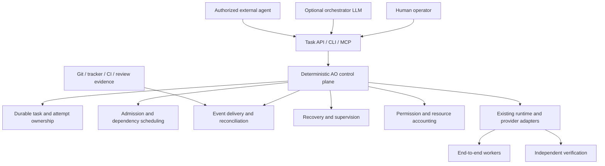

# Long-term vision: AO as an agent execution operating system

**Status:** Long-term architectural direction for this self-hosted fork, 2026-11-28. Not a description of shipped capabilities, an implementation mandate, a release commitment, or a proposal to replace the existing daemon.

## North star

AO should be a reliable, model-independent execution control plane for software engineering agents. Once an authorized task or dependency plan has been admitted, stopping the orchestrator LLM must not prevent the daemon from scheduling eligible work, observing results, routing feedback, recovering interrupted work, and releasing eligible downstream tasks within existing permissions and resource limits.

The orchestrator LLM remains useful for planning, decomposition, resolving ambiguity, and proposing changes. It is a client of the runtime, not a required component of its control loop. Workers and reviewers still require suitable execution providers; this vision does not imply that all LLMs can be switched off.

## Why

Software development is largely non-repeatable problem solving; repeatable operations should become deterministic software. Prefer an end-to-end worker responsible for an independent task (understand, design, implement, test, repair), rather than mandatory BA/architect/dev/QA agent handoffs. Independent verification remains valuable when it establishes a separate evidence or trust boundary. Split by task/context/dependency boundaries, not by simulated human job titles.

Standardize the execution environment, authorization, evidence and delivery contracts, not the worker's reasoning process. Scale complete production units rather than imposing a cognitive assembly line. Measure outcomes rather than assuming either approach is always cheaper.

## Design principles

- **Mechanism vs policy.** Deterministic daemon mechanisms enforce lifecycle, ownership, resource and safety invariants; explicit operator/project policy selects priorities, routes, budgets and acceptance gates. LLMs may propose policy or plans, but cannot unilaterally change their own authority.
- **Task vs execution attempt.** A durable logical task outlives a particular session, model, harness or process. Task identity, authorized intent, dependencies, artifact/PR association, pending work and attempt lineage must survive replacement. Reuse existing session records and claims where possible; do not introduce a competing task authority.
- **Durable facts, derived views.** Preserve the existing observe → update → derive/act architecture and SQLite/CDC boundaries. UI lanes and status projections are not sources of authority.
- **Recoverability over presumed liveness.** Expect process death, quota exhaustion, daemon restarts, transport faults and ambiguous outcomes. Distinguish confirmed failure from unknown. Checkpoint external work and evidence, reconcile before retry, and fence old writers before takeover. Never assume native conversations or hidden model state are portable across providers.
- **Reliable event delivery.** CI, review feedback, operator commands and dependency changes must survive restart and supported execution replacement. Use durable event identity, acknowledgement, deduplication, bounded retry and reconciliation; prefer at-least-once delivery with idempotent effects rather than promising exactly-once external side effects. A UI event broadcast is not a reliable task mailbox.
- **Resource-aware scheduling.** Distinguish ready/running/blocked/settled work from resident processes. Waiting tasks should release execution capacity where safe; unsupported suspension still counts toward resident limits. Account for quota windows, host resources, capability, fairness and backpressure. Never equate token counts with subscription quota.
- **Least authority.** Worktree separation is not a security sandbox. Keep daemon, worker, reviewer and operator trust boundaries explicit; use scoped capabilities, protected credentials, verified isolation and single-writer fencing. Unknown ownership or security state fails closed.
- **Independent evidence and human authority.** Completion and merge readiness require appropriate acceptance evidence, current-head CI/review and applicable owner policy. A worker's claim, stale verdict, quota exhaustion or retry limit cannot authorize merge. Human decisions remain explicit; no new automatic merge or deployment authority is implied.

## Target conceptual model

This is a responsibility map, not a mandated package layout or new service topology. Keep the Go daemon, existing ports/adapters, session manager, lifecycle reducer and storage as the foundation. The OS analogy is about execution control, not implementing a literal general-purpose OS.

## Evolution from the current fork

Existing foundations include isolated workspaces, session lifecycle/reaper, detached provider hosts for supported modes, native checkpoint and interface transition mechanisms, SQLite durable facts and CDC, tracker intake, SCM observation, quota-aware routing, review recovery, and opt-in GitHub App credential brokering. See [current architecture](architecture.md), [backend boundaries](backend-code-structure.md), [quota routing](worker-quota-failover.md), and [credential broker](github-app-credential-broker.md). Presence in the repository is not proof of deployment or production readiness.

Prefer incremental delivery through existing work:
 
| Capability | Related fork work |
| --- | --- |
| Reliable runtime and in-flight recovery | [#68](https://github.com/wangyu0426/agent-orchestrator/issues/68), [#71](https://github.com/wangyu0426/agent-orchestrator/issues/71), [#72](https://github.com/wangyu0426/agent-orchestrator/issues/72), [#73](https://github.com/wangyu0426/agent-orchestrator/issues/73) |
| Feedback delivery and review convergence | [#57](https://github.com/wangyu0426/agent-orchestrator/issues/57), [#58](https://github.com/wangyu0426/agent-orchestrator/issues/58), merged [#66](https://github.com/wangyu0426/agent-orchestrator/pull/66) and [#70](https://github.com/wangyu0426/agent-orchestrator/pull/70) |
| Admission and dependency scheduling | [#16](https://github.com/wangyu0426/agent-orchestrator/issues/16), [#6](https://github.com/wangyu0426/agent-orchestrator/issues/6), [#42](https://github.com/wangyu0426/agent-orchestrator/issues/42) |
| Accounting and capability-aware routing | [#50](https://github.com/wangyu0426/agent-orchestrator/issues/50), [#62](https://github.com/wangyu0426/agent-orchestrator/issues/62), [#63](https://github.com/wangyu0426/agent-orchestrator/issues/63) |
| External task access | [#64](https://github.com/wangyu0426/agent-orchestrator/issues/64) |

After validating these slices, assess whether a unified task control block, durable task mailbox and generalized supervisor are warranted. Reuse the contracts proven by actual failure scenarios, notably #73, rather than prematurely adding parallel abstractions or a second dispatcher. Strengthen host-level isolation before untrusted or multi-user execution; this is a prerequisite, not optional polish for such deployments. Resolve overlaps in the backlog before opening new implementation issues.

## Long-term acceptance

The reference scenario is an explicitly authorized disposable project with an independent task and a dependency chain. Turn off the orchestrator LLM while keeping the daemon, eligible worker/reviewer providers and required external services available. Demonstrate that:

1. Eligible tasks are admitted within resource limits; blocked tasks wait until their declared gates are satisfied.
2. The daemon routes CI/review failures to the correct task and preserves pending work across restart.
3. A quota refusal or recoverable worker failure can park or replace an attempt without losing changes, duplicating PRs or allowing competing writers. Uncertain recovery safely stops for operator action.
4. Current-head evidence drives review/merge readiness; human merge authorization remains required under the existing policy.
5. Once the prerequisite is legitimately merged, its eligible dependents are released without an orchestrator model call.
6. Every task has auditable ownership, attempt lineage, failure/recovery reasons and terminal evidence. No silent loss, unauthorized side effect or indefinite retry is accepted.

Validate with deterministic fake-provider fault injection, race/restart tests and opt-in live smoke tests. For supported workloads, track delivery success, human interventions, recovery success, duplicate/lost events and writes, time to ready-to-merge, resource consumption and cost per accepted task. Establish baselines before selecting numerical targets. A sustained unattended soak with intentional failures should precede broader promotion; safety stops and required human decisions are correct behavior, not failures of autonomy.

## Non-goals

No mandatory role-based multi-agent team, new general-purpose OS, inference engine, universal cross-provider conversation migration, separate workflow engine, wholesale rewrite, or replacement of Git/CI/tracker systems. No change to deployed configuration, privileges, review/merge authority or upstream compatibility is authorized by this document. Implementation remains independently scoped, tested and reviewed.
