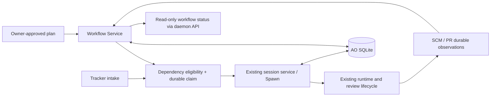

# Deterministic dependency-driven workflow service

Status: **proposal / design for review**, 2026-11-25. Tracking: [#42](https://github.com/wangyu0426/agent-orchestrator/issues/42). No implementation or production activation is authorized by this document.

## 1. Problem and outcome

A developer knows that task B must start only after task A's implementation PR merges into the intended target branch. Today the owner or orchestrator must notice the merge and dispatch B. Launching both early can cause overlapping changes and rebase churn; asking an agent to poll or decide an already-known condition wastes attention and model quota.

Concrete motivating example: #40 / PR #41 before #39. These live issues are examples only; no automatic dispatch or retroactive enrollment is requested.

**Outcome:** the owner approves a dependency plan once. AO waits for authoritative merge evidence, then releases the successor for normal worker intake from the updated base. No model call is needed to evaluate the dependency, advance the plan, or recover a scheduling interruption.

## 2. Historical upstream context and divergence

Upstream OrchestratorInc/agent-orchestrator previously proposed a declarative pipeline architecture: [#1345](https://github.com/OrchestratorInc/agent-orchestrator/issues/1345) (vision), [#1346](https://github.com/OrchestratorInc/agent-orchestrator/issues/1346) (engine and persistence), [#1349](https://github.com/OrchestratorInc/agent-orchestrator/issues/1349) (DAG, dependsOn and conditions), [#1350](https://github.com/OrchestratorInc/agent-orchestrator/issues/1350) (workbench), and [#1351](https://github.com/OrchestratorInc/agent-orchestrator/issues/1351) (workstream scope and cross-worker merge events). The four delivery sub-issues were closed as not planned when inspected on 2026-11-25. They describe the old TypeScript architecture, not evidence that the current Go daemon ships a reusable pipeline engine. #1351's pipeline-driven spawn was itself optional/deferred in that design. [#3163](https://github.com/OrchestratorInc/agent-orchestrator/issues/3163) documents the separate problem of overlapping PRs and cross-session conflict churn; [#4511](https://github.com/OrchestratorInc/agent-orchestrator/issues/4511) proposes a richer orchestrator runtime.

The desired capability is aligned with historical upstream needs, but the fork chooses a narrower implementation and more deterministic execution. A branch comparison on 2026-11-25 reported fork main 78 commits ahead and 311 behind upstream main; these are a dated snapshot, not a permanent measure. Recheck before implementation. Prefer a small additive service and stable ports, so upstream harness, lifecycle, and UI changes remain mergeable. Do not revive the old TypeScript engine or infer the upstream roadmap from closed issues. No upstream submission is assumed.

## 3. Scope and non-goals

MVP: single AO project, one tracker/provider and target branch per approved plan, a sequence of existing issue-sized tasks, merge-evidence gates, persistent dispatch identity, reconciliation, and inspectable blocked reasons. A minimal explicit dependency list may represent a chain; reject cycles and ambiguous references. Support a pinned PR gate separately from an issue's associated implementation PR gate.

Not MVP: automatic issue decomposition, automatic merge, general workflow DSL, arbitrary scripts/conditions, cross-project distributed orchestration, automatic conflict resolution, replacement of the Session Manager or reviewer, new model/harness, hosted service, new network listener, or mandatory workflow for existing independent tasks. Parallel branches, all-of fan-in and human gates are future extensions, not prerequisites.

## 4. Architectural boundary

Proposal: a **logically independent Go Workflow Service within the existing AO daemon**, not a new deployment/process. Candidate package backend/internal/service/workflow. The exact package/interface names are not fixed before inspecting current main.



- Workflow Service owns approved plan revisions, dependency evaluation, release/claim/reconciliation facts and explicit operator actions. It has no provider runtime, Git credential, review submission or merge authority.
- Tracker intake remains the normal admission/dispatch path. Workflow Service exposes eligibility/claim behavior to that path; it must not become a second worker dispatcher. A plan-managed successor is reserved even if assigned upstream before its dependency is satisfied. Manual spawn of a reserved issue must use the same admission boundary or an explicit audited owner override; no silent bypass.
- SCM observer and existing PR association/store supply authoritative evidence. Observe events as wakeups; durable facts/reconciliation decide transitions. Never treat comments, model text, a webhook alone, issue closure, CI green, review approval or an idle session as proof of merge.
- Session service retains worktree creation, runtime launch, permissions, model/effort routing, quota/concurrency gates, and lifecycle. Workflow Service never directly creates worktrees or launches processes.
- Daemon wiring, existing SQLite migrations/query generation, API and CDC conventions remain authoritative. UI/CLI are thin clients of daemon API; no direct SQLite access. No private state-repo dependency.

### Existing code evidence and gaps (main inspected 2026-11-25)

- `backend/internal/observe/trackerintake/observer.go`: opt-in observer polls matching open tracker issues, derives canonical provider-aware issue IDs, builds prompts, and calls existing `Spawner.Spawn`. Its in-process poll mutex and seen set of **non-terminated** sessions are not by themselves a durable exactly-once workflow claim. It already handles quota-deferred/no-ready-route and paused-auto-spawn outcomes.
- `backend/internal/daemon/tracker_intake_wiring.go`: wires observer to existing session service and SQLite store behind global and project intake enablement. Reuse this admission path rather than add another independent poll-to-spawn loop.
- `docs/architecture.md` and `AGENTS.md`: observe durable facts, derive display status, ports for external adapters, Go daemon owns state, SQLite CDC via triggers; respect existing lifecycle and API boundaries.
- Before implementation, inspect actual session-spawn transaction, idempotency/identity support, PR association and target branch freshness, all manual/automatic spawn entry points, restart recovery, and the current upstream diff. This document does not claim these gaps have already been solved or prescribe unsupported API signatures.

## 5. Behavior contract

### 5.1 Plan and identity

A plan revision contains an immutable plan ID/revision, approved actor/time, project and provider/repository identities, expected target branch, task nodes with canonical tracker IDs, and typed dependency gates. Plan creation is a proposal until explicit authorization; activating one reserves its successor nodes atomically. At most one active reservation for a given project/task identity; duplicates or incompatible active work require an operator decision. No automatic re-enrollment of previously finished tasks. Record changes as new revisions; no silent mutation of an approved plan. Cancellation/revision changes fence old pending claims, not already-running agents.

Illustrative data only, **not an existing configuration schema**:

```yaml
project: example
target: main
tasks:
  - id: A
    issue: provider:owner/repo#100
  - id: B
    issue: provider:owner/repo#101
    after:
      - task: A
        gate: implementation_pr_merged
```

No untrusted issue text, label, or PR body may independently activate a plan or select a new dependency. The authorizing actor and existing tracker eligibility rules remain required.

### 5.2 Gate evidence

For an issue dependency, require an unambiguous associated implementation PR for that exact task, not a mention in a comment or a docs-only PR associated with the tracker. For a pinned PR gate, require its explicit immutable provider/repository/PR identity. Confirm merged state, correct repository and base branch through SCM-backed facts; record PR identity, merge commit/evidence, observation time and source. If an integration cannot establish authoritative merge state or branch freshness, block rather than guess. Merged PR evidence is historical; a later revert is not silently treated as a new dependency cycle. A known revert or missing ancestry before dispatch blocks for operator review.

The worker must start from the current target branch after the prerequisite merge is incorporated (verify fetched base/merge evidence using the existing workspace path). Do not accept a stale checkout or merely compare timestamps. If merge strategies or provider facts do not permit reliable verification, surface unsupported/unknown and defer.

### 5.3 Transitions and admission

| Fact / transition | Required behavior |
|---|---|
| Draft or invalid plan | No reservation or auto-dispatch. |
| Approved, predecessor not merged | Reserved successor remains blocked. |
| Verified expected merge | Successor eligible for existing intake; not a merge or launch in itself. |
| Intake disabled, quota/route/capacity unavailable | Remain eligible/deferred; no bypass; re-evaluate through existing policy. |
| Durable claim acquired | One dispatch identity for this plan node/attempt; only claimant may initiate Spawn. |
| Session durably linked | Record session identity; repeated observations cannot spawn another worker for that attempt, even if session later terminates. |
| PR merged for this node | Record terminal merge evidence; release next dependent if present. |
| Failure, ambiguous PR, closed-unmerged PR, unknown dispatch outcome | Block or pause with reason; no implicit success or blind duplicate dispatch. |
| Explicit retry/cancel/repair | Audit actor and reason; retry creates a new attempt only after previous identity is reconciled and no conflicting work is active. |

Display status (blocked/ready/dispatching/dispatched/completed/paused/failed) is a projection from durable workflow facts. Do not add derived session status columns. A failed or unknown runtime probe is not proof of agent death. A cancelled plan cannot authorize new dispatch, but cancellation alone does not kill running workers or revert merges.

### 5.4 Crash and concurrency contract

Use durable claim/attempt identity with an atomic uniqueness constraint or equivalent transaction/CAS in existing AO persistence. Repeated events, simultaneous intake and workflow polls, and restart must not create two sessions for one attempt. Crucial crash boundary: if Spawn succeeds but the caller fails before recording the returned session ID, reconcile using a stable persisted correlation key attached to session creation. If existing Spawn cannot establish that contract, extend its narrow admission/idempotency boundary or fail closed as uncertain, never blindly retry. A timeout or lost response is not proof no session exists. Claims must be reclaimable only after evidence establishes no previous dispatch side effect; leases alone are insufficient. Gate checks and authorization must be fenced against cancellation/revision changes up to the irreversible admission boundary. Do not hold SQLite transactions across SCM/network/process I/O. Store only durable facts; no new manual CDC channel.

## 6. Minimal operator surface

Propose/validate a plan, approve/activate, inspect nodes and reason/evidence, pause/cancel, and explicitly retry or repair unresolved association. Start with daemon API + thin CLI if sufficient; visual workflow builder is not required. The exact syntax and API shape are implementation-design decisions. Default off / opt-in; existing independent issue intake unchanged. No automated change to tracker assignees, production routing, existing approvals, or reviewer policy.

## 7. Verification and acceptance

Use fake SCM/tracker, injected clock, fake or instrumented session admission and temporary SQLite; no model quota/network required for deterministic tests. Verify actual behavior, not just state strings.

- Happy path A -> B: B cannot dispatch before A's merge, including when already assigned; open/approved/CI-green A PR does not release it. Correct associated merge releases B, exactly one session is created from fresh base containing the merge.
- Unrelated PR, docs-only PR, wrong repo/base, ambiguous associations, closed-unmerged, missing SCM evidence, stale base, and known revert: no release/dispatch.
- Repeat the same event and polling cycles; run concurrent poll/manual admission; restart before claim, after claim, after session commit before response/ack, and after link. Never duplicate a session. Unknown outcome is visible and recoverable only via evidence or explicit operator repair.
- Reconcile terminated prior sessions, cancellation/plan edits racing with dispatch, explicit retry, duplicate reservation, invalid identity and cycle validation. Existing unrelated tracker tasks still dispatch normally.
- Global/project intake disabled, quota deferred, no route, paused automation, admission/capacity refusal: no bypass and truthful blocked/deferred status.
- Preserve current PR exact-HEAD review and merge rules; no automatic merge, permission relaxation or model call from scheduler. Verify normal worker, reviewer, orchestrator and non-workflow paths remain unchanged.
- Run relevant Go unit/race/integration tests, migration/sqlc regeneration and API drift checks if touched, plus required CI. An opt-in disposable-repo live smoke may follow core acceptance; report any environment gap separately. Do not use #41/#39 production sessions as test fixtures.

## 8. Delivery slices and open decisions

First do a bounded code investigation; establish the actual durable admission contract and merge evidence APIs, then update this proposal and open independently reviewable cards. Candidate order (not assignments): (1) plan validation/reservation and pure gate tests; (2) durable release/claim integrated into existing intake with crash/restart tests; (3) minimal operator interface and disposable end-to-end smoke. Each slice must compile and pass its own contracted tests, with feature disabled until full safe admission is available. No fake blockers or unrelated refactors.

Open: whether existing spawn offers atomic durable correlation; exact PR-to-issue authority and handling multiple implementation PRs; base freshness mechanism across supported SCMs; minimum API/CLI shape and migration/rollback compatibility. If a narrow integration cannot preserve existing upstream contracts, revisit the service boundary rather than broaden Session Manager ownership by default.

**Decision rule:** agentic planning decides what to do; deterministic execution decides when an explicitly approved step is eligible. Routine scheduling does not call a model. Preserve independent review and human merge authority.
