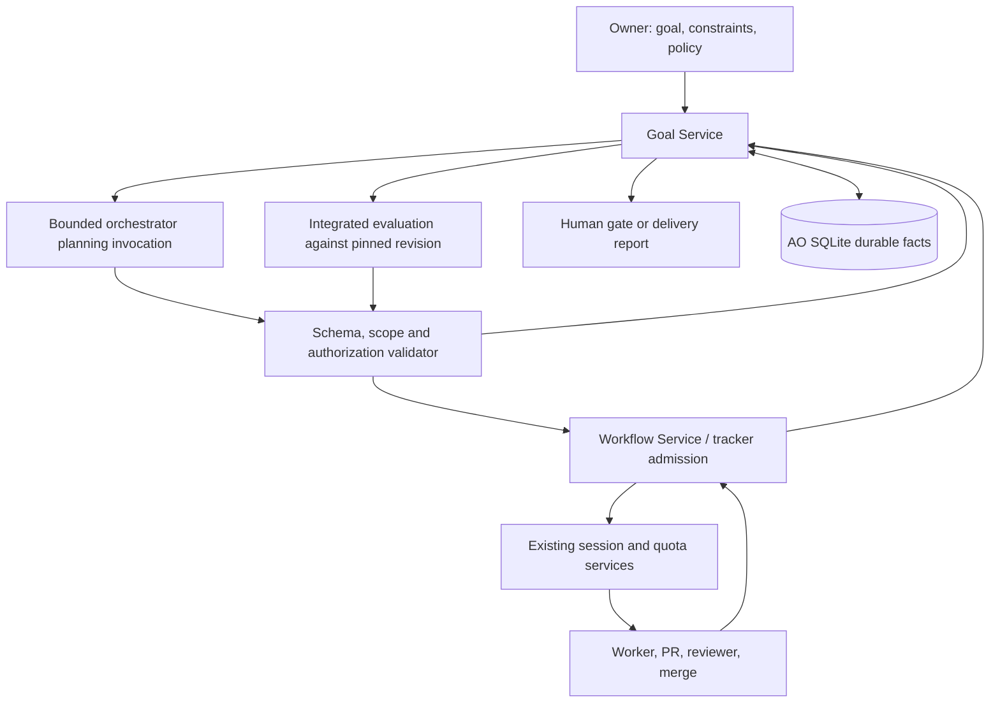

# Goal Mode: persistent goal-driven orchestration

Status: **proposal / design for review**, 2026-11-26. Target: the Go daemon in this fork, not the separate agent-operator project. No implementation, automatic dispatch, auto-merge, or production configuration is authorized by this document.

Related proposals: [#42 deterministic dependency-driven workflow](https://github.com/wangyu0426/agent-orchestrator/issues/42), [Workflow Service design at reviewed revision](https://github.com/wangyu0426/agent-orchestrator/blob/fdafc440061b9565ccabe636a6c138e7c8ed02ac/docs/superpowers/specs/2026-11-25-deterministic-workflow-service-design.md), [#7 optional auto-merge](https://github.com/wangyu0426/agent-orchestrator/issues/7), [#34 deterministic PR creation](https://github.com/wangyu0426/agent-orchestrator/issues/34). These are dependencies or adjacent proposals, not assumed shipped capabilities.

## 1. Problem and outcome

Task Mode already supports a human-authored issue becoming a worker session through tracker intake, with daemon-owned routing and review. Project bootstrap (#52) makes that flow usable on new repositories without starting a project orchestrator. However, completing a series of issues is not equivalent to delivering the product described by a specification.

Desired owner experience: provide a versioned specification and say **"build this game"**. AO should inspect the repository and specification, propose a plan, execute authorized tasks, run the integrated product, evaluate evidence against the specification, identify gaps and replan until a defined stop condition. The owner should not have to manually create each successive issue. The goal survives process exits, daemon restarts, model changes and days-long work.

The outcome is an inspectable, revision-pinned delivery with an acceptance report, not an unconditional guarantee of a complete or enjoyable game. Subjective quality and unobservable requirements need explicit evaluation and, where required, owner judgment.

**Principle:** uncertain questions go to models; deterministic processes go to software; risk decisions go to humans.

## 2. Scope and modes

- Task Mode: retain current independent issue intake, manual dispatch, project orchestrator behavior, worker/reviewer lifecycle and merge policy. No automatic enrollment.
- Goal Mode: explicit opt-in, one active goal per project in MVP, single authorized repository and target branch, goal-scoped planning, dependency-managed execution, integration evaluation and iterative gap closure.
- Goal Mode does not require a resident project orchestrator. A logical orchestrator can consist of many bounded invocations with a durable shared context. Existing interactive orchestrator sessions remain available and are not silently converted.
- MVP can use a linear milestone workflow; parallel DAG/fan-in require corresponding verified Workflow Service capabilities. No cross-project execution, arbitrary workflow scripts, new agent harness, hosted control plane, persistent autonomous browser, automatic production deploy, unrestricted autonomous spending, or replacement of review/session services.
- Manual merge is the default. A separately approved, implemented merge policy may later permit eligible merges; Goal Mode alone never grants that authority. Manual approval of required milestones and merges may interrupt hands-off operation.

## 3. Architecture and ownership



- Goal Service (candidate additive Go service) owns goal revisions, approved intent, milestone/plan versions, evaluation evidence, budget ledger, bounded invocation identities, audit log and derived goal status.
- Workflow Service #42 owns task reservations, dependency eligibility, claims and dispatch reconciliation. Tracker intake remains the normal admission path. Goal Service must not poll issues and directly spawn duplicate workers, bypass reservations or implement its own SCM merger.
- Existing session/runtime services own worktree setup, model routes, quota/concurrency, permissions and runtime lifecycle. Use existing APIs/ports where possible. Exact APIs and package boundaries require current-main investigation.
- Orchestrator is a planning/evaluation capability, not the control plane. Invoke through existing supported harness/session facilities with bounded time/context and role-specific routing. Planner proposes actions; it does not receive unrestricted direct write/merge/dispatch privileges. Evaluator provides evidence and judgments; it cannot approve its own risky work or rewrite requirements.
- UI/CLI are thin clients of the daemon API. Store durable facts in existing SQLite conventions; do not add a separate scheduler process, external data store or private state-repository runtime dependency.
- Existing reviewer remains independent of task implementation. Product evaluation is separate from PR review: green tests and reviewed code do not establish that the integrated product meets the goal.

## 4. Goal contract and authorization

Immutable goal revision contains: goal ID, project ID, repository identity, target branch, source spec path and full Git revision (or immutable uploaded artifact and content digest), authorized owner/time, structured requirement IDs, explicit non-goals, constraints, acceptance methods, approved capability/risk envelope, budget and stop rules. Record a human-approved requirements interpretation for ambiguous source prose before execution. Preserve the original spec; changing scope, constraints, acceptance or spending authority requires a new approved revision. No model may weaken the spec or delete unmet criteria to finish.

Illustrative interface, **not existing CLI or configuration**:

```yaml
goal:
  project: example-game
  target: main
  spec:
    path: docs/game-spec.md
    revision: "<full commit SHA>"
  acceptance:
    - id: G-01
      method: automated
      description: playable run from start to win or loss
    - id: G-02
      method: human
      description: combat feels responsive and readable
  policy:
    create_issues: true
    dispatch_approved_plan: true
    merge: manual
    deploy: false
    allowed_repository: owner/example-game
  limits:
    max_tasks: 20
    max_planner_invocations: 8
    max_evaluator_invocations: 8
    max_replans: 4
    max_attempts_per_task: 2
    max_parallel_workers: 2
    wall_clock_hours: 48
```

Limits are examples, not defaults. Start requires an explicit validated policy and finite limits. Approval of a goal may preauthorize routine plan materialization and dispatch **inside** the envelope, avoiding repeated owner clicks; alternatively require per-plan approval. If the MVP cannot enforce the envelope, require per-plan approval. Protected changes, new external services, new repository access, credentials, destructive changes, budget expansion and production actions require separate authorization. Untrusted spec/issue/PR/log content cannot grant new privileges. Treat all fetched project material as data, not policy; identity of the owner and approval must come from the trusted daemon/operator interface.

## 5. Persistent execution loop

1. **Propose and authorize:** validate spec revision, project identity, constraints, budget and acceptance map. No worker dispatch before authorization.
2. **Plan:** invoke orchestrator with repository snapshot, goal/spec revision, requirements, existing tasks, current evidence, available tools, budget and allowed actions. Return a structured plan: milestone IDs, task intent, dependencies, acceptance criteria, affected scope, estimates and relevant requirement IDs. Validate cycles, scope, duplicate/overlapping work, authorization and limits. Unknown requirements produce a question, not a guessed decision.
3. **Materialize and execute:** reserve workflow tasks before enabling their normal intake. Create or adopt explicitly identified tracker issues via authorized APIs, then release only dependency-eligible work. Existing worker/PR/review/merge flow remains in charge. Never treat an issue assignment as an authorized bypass. No repeated LLM polling while waiting.
4. **Observe:** durable SCM merge and workflow facts advance the milestone. Failures use bounded existing recovery; escalate when the agreed retry limit is reached or authority/evidence is missing.
5. **Evaluate:** at milestone or goal checkpoint, pin the actual integrated target commit after all required merges. Run approved evaluation commands in an isolated workspace with bounded time/resources and safe output/artifact capture. Map each requirement to pass/fail/unknown/human_required plus evidence.
6. **Replan or stop:** deterministic service validates evidence and outcome. If material gaps remain, invoke planner with prior plans, failing requirements, evidence and remaining budget; propose only necessary new tasks. If all required acceptance gates pass and final revision is current, submit final report. If no progress, uncertain evidence, human decision or budget exhaustion prevents continuation, stop with explicit reason and resume action.

Events are wakeups, not authority. Wake on new authorized goal, milestone completion, actionable failure after retries, evaluation completion, owner response, or reconciled restart. Quota deferral, CI waiting, manual merge waiting and repeated polling are not planning triggers. Coalesce duplicate notifications, use one in-flight planner/evaluator per goal in MVP and fence old results.

## 6. Bounded invocation protocol

Every invocation has goal ID/revision, plan revision, phase, triggering event ID, immutable input snapshot/digest, expected target revision, attempt ID, route and resource reservation. Persist before launch. Return a strict versioned result envelope (proposal only):

```json
{
  "schemaVersion": 1,
  "goalId": "goal-1",
  "goalRevision": 1,
  "planRevision": 2,
  "invocationId": "invocation-7",
  "inputDigest": "sha256:...",
  "targetRevision": "...",
  "decision": "propose_plan",
  "tasks": [],
  "requirementEvidence": [],
  "questions": []
}
```

Decision types by phase: propose_plan, request_owner_input, report_evaluation, report_blocked. Daemon derives state; no model-provided "done" flag is authoritative. Validate schema, referential integrity, result size, phase, snapshot and current authorization. Reject stale, malformed, oversized or cross-goal results without executing any action. Preserve rejected result metadata and sanitized diagnostic, and retry only within policy. Do not execute model-produced shell strings as scheduling commands. Existing approved tool/runtime policy applies to evaluator commands.

Keep model sessions disposable or explicitly resumed for a bounded attempt; never require conversation history for correctness. Durable context must include decisions, rationale, goal/plan versions, pending work, evidence, unresolved questions and remaining limits. Persist provider references where needed, not secrets or raw unlimited transcripts. Invocation launch and completion use correlation IDs and reconcile ambiguous outcomes; an expired lease is not proof the previous invocation stopped.

## 7. Evidence and acceptance for games

Separate three layers:
- Task verification: worker tests, independent review, required CI, approved merge. These are necessary per-task gates, not proof of product success.
- Integration verification: execute the actual pinned build in isolated workspace; exercise a real end-to-end loop, collect test/run results, logs and optionally bounded screenshots or replay traces. Example: start a run, level up, select equipment, encounter enemies, end with win/loss; validate behavior and counters where the spec defines them.
- Product judgment: assess requirements not fully expressible as deterministic tests, such as readability, art consistency, combat feel or fun. Agent judgments may flag problems and propose fixes. Require human acceptance where configured; distinguish model-assisted evidence from human judgment and automated assertions.

An evidence record contains requirement ID, goal revision, target SHA, method, tool/evaluator identity, commands or scenario IDs, status, time, result/artifact digest and limitations. Unknown, skipped, unsupported or stale evidence is not pass. No evaluator self-certification based solely on summaries, screenshots from a different revision, generated tests not run, or worker claims. Pin evaluation to integrated target, not a feature branch; if target changes, invalidate affected evidence and require fresh final evaluation at the current target SHA. Independent unrelated target changes must be reconciled rather than silently included in the goal's deliverable.

A completion report contains final commit and runnable instructions, acceptance coverage/evidence per requirement, linked tasks/PRs, known limitations, remaining risks and actual budget usage. Mark complete only after all mandatory gates are satisfied and any required owner judgment is recorded. No goal success on "all tickets merged" alone. A human may terminate with an explicitly incomplete delivery, never silently mark unmet requirements passed.

## 8. State, recovery and budgets

Durable facts include goal revisions/approvals, plan and requirement mapping, task reservations/correlation, invocation attempts, evidence, owner decisions, budget reservations/usage, cancellation fences, event deduplication and reconciliation metadata. Derive display phase: draft, planning, awaiting_approval, executing, awaiting_merge, evaluating, replanning, deferred, awaiting_human, blocked, budget_exhausted, completed, cancelled. State is not a second session status system.

- Use atomic reservation/CAS and stable operation IDs. Tracker issue creation/assignment and session launch are external side effects: reconcile using durable correlation and authoritative reads before retry; unknown outcomes fail closed. If provider cannot safely establish identity, require owner repair instead of duplicate issue creation.
- Fence against plan revision changes/cancellation at the irreversible admission boundary. Pausing stops new operations, does not kill active workers or undo merges. Resume uses fresh authorization/evidence. Existing work needs explicit handling before a replacement plan takes effect.
- Preserve goal and ledger through restart, agent/model changes, daemon outage and duplicate events. Never hold SQLite transaction across model/network/process I/O.
- Bound task count, attempts, planner/evaluator calls, replan count, wall time and concurrency. Reserve before admission; account for failed and ambiguous launches; unknown cost cannot be treated as free. Use actual token/spend ceilings only if provider telemetry and enforcement are reliable. Otherwise enforce count/time/quota-based limits and disclose that these are not monetary guarantees.
- Quota unavailability defers through current router; no unapproved provider, routing or model change. Budget exhaustion stops new work until explicit owner extension; no auto-renew.
- Detect no progress (e.g., unchanged failed requirement/evidence on consecutive checkpoints), repeated task proposals and cycles; block instead of infinite repair. Distinguish genuine failure from waiting for an approved merge or quota reset. Stop even when goal is unmet if limits are reached.

## 9. Minimal operator surface

Illustrative only: create goal from pinned spec; inspect goal, current phase, plan and outstanding requirements; approve policy/plan; pause/resume/cancel; answer a question; approve a human gate; extend limits; obtain delivery report. CLI/API first, UI later. Show why execution is waiting, current target revision, budget and next authorized operation. The existing project "Start Orchestrator" control remains unchanged initially; Goal Mode is opt-in and has its own lifecycle.

## 10. Acceptance and verification

Use a disposable synthetic repository, fake planner/evaluator/SCM/tracker/harness, temporary SQLite and injected clocks. No live user projects as fixtures, no real provider calls required for deterministic CI.

- Task Mode and independent issue intake continue unchanged; enabling Goal Mode does not start a resident orchestrator or enroll old issues.
- Authorized pinned spec -> planner proposal -> validated plan -> exactly-once task materialization/admission via Workflow Service -> merged prerequisite -> integrated evaluation -> failing criterion -> revised task -> fresh evidence -> completion. Simulate a small runnable game or equivalent toy CLI; first evaluation must intentionally fail a required functional criterion despite all initial tasks being merged.
- Verify no plan creates tasks or dispatches before approval; reject out-of-scope repositories, cyclic/duplicate dependencies, conflicting work, policy escalation, malformed/stale results and untrusted instructions. Ensure independent PR review and manual merge gates cannot be bypassed by planner/evaluator.
- Missing, skipped or stale evidence blocks completion, including target revision changing during evaluation. Human-required criterion stays pending even with green CI and positive model opinion; explicit owner decision is recorded. Budget exhaustion, no progress, cancellation and unresolved ambiguity yield truthful incomplete reports.
- Crash/restart at invocation launch/response, tracker materialization, claim/session creation, merge observation and evaluation publication; duplicate events and racing cancellation/plan revision cannot create duplicate work or accept stale results. Preserve pending approval and limits across restart.
- No LLM calls on routine polls, known dependency gates, quota wait, CI wait or merge wait. Route selection and fallbacks remain owned by existing services.
- Run relevant Go unit/race/integration tests, migrations/sqlc/API drift checks and CI for changed surfaces. After deterministic tests pass, explicitly authorize a bounded real-harness smoke in a disposable repo: one goal, at least one evaluation-driven follow-up, no resident orchestrator, independent review, human merge/acceptance and restart recovery. Record actual calls, waits, outcomes and gaps.

## 11. Delivery slices (proposed, not assigned)

- G0: code investigation and contract freeze. Reinspect current main and #42 implementation status, tracker creation capabilities, admission/idempotency, routing, invocation/report APIs and evaluator sandbox. Resolve missing interfaces before implementation.
- G1: Goal persistence, versioned spec/requirement map, policy, approvals, finite budget and status API. Pure/state tests; no model calls.
- G2: Bounded planner invocation, schema validation and durable context. Fake harness, recovery, invalid/stale proposals; no production task dispatch.
- G3: Approved-plan materialization and integration with #42 admission/merge evidence. No duplicate dispatcher; end-to-end synthetic milestone with manual merge.
- G4: Revision-pinned integration evaluation, evidence map, human gates, incomplete delivery and final report.
- G5: Replanning loop, no-progress detection, limits/recovery and real-harness opt-in smoke. Only now enable complete Goal Mode for approved test projects.
- Later: richer DAG/fan-in, separately approved auto-merge, optional higher-quality visual evaluator, multi-project goals, UI improvements. None are prerequisites for the constrained first goal.

Each slice is an independently reviewable PR with concrete acceptance tests; maintain feature disabled until safe behavior is complete. Recheck #42 dependency before G3; do not assume its design is merged or implemented. If necessary, implement its smallest safe sequential admission first.

Open decisions: how to provision least-privilege planner/evaluator tools with current harnesses; exact evidence sandbox/artifact interface; durable tracker correlation across providers; semantics for unrelated target changes and multiple implementation PRs; reliable provider budget measurement; policy defaults and owner approval UX.

**Success metric:** the owner can authorize a bounded spec, leave the control plane to run routine work without an always-on LLM orchestrator, and return to an evidence-backed completed or explicitly blocked goal. A complete project remains contingent on the spec, execution quality, observable evidence, budgets and human acceptance.
