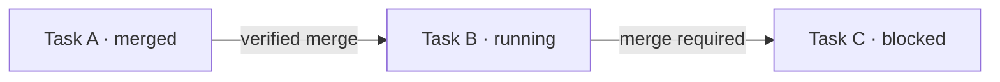
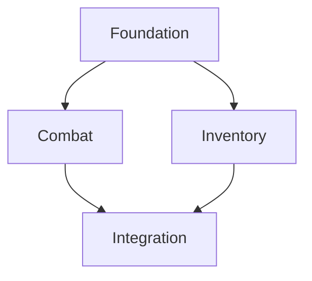
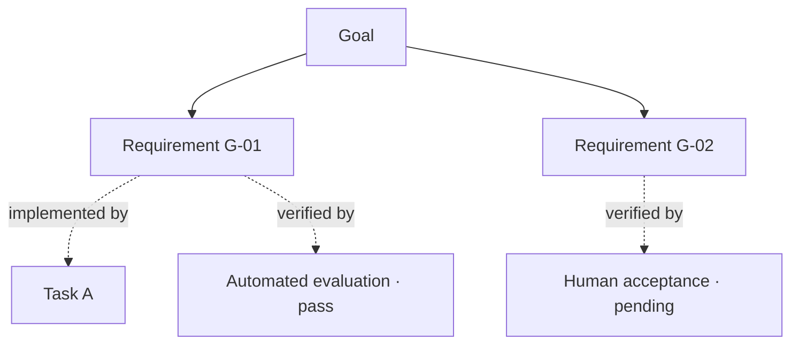

# Workflow Graph UI — Pipeline, Dependency Tree and execution evidence

Status: **proposal / design for review**, 2026-11-26. Target: Electron + React frontend of the Go AO fork. Documentation only; no implementation, deployment or task dispatch authorized.

Related designs: [#42 Workflow Service](https://github.com/wangyu0426/agent-orchestrator/issues/42), [workflow proposal](https://github.com/wangyu0426/agent-orchestrator/blob/fdafc440061b9565ccabe636a6c138e7c8ed02ac/docs/superpowers/specs/2026-11-25-deterministic-workflow-service-design.md), [#53 Goal Mode](https://github.com/wangyu0426/agent-orchestrator/pull/53). Both are design dependencies, not assumed shipped features.

## 1. Problem and outcome

AO currently exposes project and agent activity through its supervisor. A list of issues or agent sessions does not explain why work exists, which tasks depend on others, where a delivery is blocked, or whether the product has satisfied its goal.

Add a project-scoped **Workflow** view that makes an authorized execution plan visible and inspectable. A new viewer should understand the execution order, parallel work, current bottleneck and next gate at a glance; an operator should be able to navigate to the precise issue, session, PR or evidence explaining it.

This is both a product presentation surface and an operational tool. Prefer a clean graph of compact cards with legible connectors over an agent chat transcript or an animated wall of status lights. The UI must remain truthful when real work is waiting for CI, quota, merge or a person.

## 2. Scope

- V1: horizontal Pipeline for a single workflow, including sequential merge gates and task state, read-only inspector, zoom/pan/fit, live status updates and navigation to existing surfaces.
- V2: top-down Dependency Tree / DAG and compact large-plan view, only showing actual authorized dependency edges. Support fan-out/fan-in once the workflow contract supports them. A containment-only tree is a separate view/layer, not a dependency graph.
- V3: Goal and Acceptance views over Goal Mode's requirements, milestones, plan revisions, integrated evaluation and evidence.
- All views share one authoritative graph projection, stable entity IDs, inspector and status vocabulary. Do not invent new business logic for each layout.
- Non-goals: visual workflow authoring or arbitrary DSL, auto-merge, drag-to-dispatch, LLM layout, replacing the existing board/session view, new runtime, mobile redesign, cross-project graph, or separate graph database. Editing plans can be considered later with explicit daemon validation and authorization.

## 3. Information architecture

Proposed entry: existing project navigation -> Workflow. Preserve current project/agent screens and selection. Exact route and component paths are determined after inspecting the frontend.

Screen:

```text
┌──────────────────────────────────────────────────────────────────────────┐
│ Project / Workflow name    Plan v3 · main      Live / last updated        │
│ Pipeline | Dependency | Goal* | Acceptance*   Search    Filter    Fit    │
│ 2 / 4 tasks merged    1 running    1 waiting for merge                    │
├─────────────────────────────────────────────────────┬────────────────────┤
│                                                     │ Selected task      │
│ [A ✓] ───> [B running] ──┐                         │ #12 · AGY worker   │
│   └──────> [C review] ───┴───> [D blocked]          │ Why blocked/active │
│                                                     │ Dependency evidence│
│                                                     │ Session / PR / CI  │
│                              −  100%  +   Fit       │ Attempts / events  │
└─────────────────────────────────────────────────────┴────────────────────┘
* Goal-specific views appear only when the backend supports them.
```

Top bar: workflow/goal identity, target branch, plan revision, aggregate counts, freshness, layout switch. Main canvas gets most of the available width; inspector opens on selection and can be collapsed. Keep toolbar and inspector outside the pan/zoom canvas. Use current AO typography, spacing, color tokens, dark/light modes, icons and UI primitives instead of introducing a competing design system. At narrow widths, collapse the inspector into a drawer and provide a readable ordered list fallback.

Aggregate counts are daemon-backed or deterministic counts of visible authoritative facts; identify whether filters affect them. Task merge progress and requirement acceptance progress are separate denominators. Do not report a single misleading project-completion percentage.

## 4. Graph projections

### A. Pipeline — default

Left-to-right dependency order, with the simplest sequential plan appearing as one clean row. Show task cards as the primary nodes. A visible merge gate can be a labeled edge or compact gate between tasks; within a selected task, show Issue -> Worker -> PR -> Review/CI -> Merge as lifecycle details, not independent scheduled tasks. Use actual state and independent review/CI substatus rather than implying a universal linear order for those concurrent activities.



For supported branches, align tasks with equal topological rank in lanes; use orthogonal edges and clear ports. Preserve input order only as a deterministic tie-breaker, never create edges based on screen order. Keep the current focus visible without auto-scrolling away from operator selection.

### B. Dependency — top-down tree-like DAG



This is the same dependency graph in top-to-bottom orientation, with shared downstream tasks rendered once. Fan-in means all specified gates are satisfied only where backend semantics explicitly say so. Do not duplicate task D to simulate a strict tree, infer dependencies from milestone membership, or fabricate parallel execution from a sequential workflow.

Optional Goal hierarchy shows Goal -> Milestone -> Task as containment, using visibly distinct grouping/edge semantics and an explicit legend. Cross-milestone dependencies remain real dependency edges. Large graphs can collapse milestone groups, displaying aggregate counts and explicit hidden-dependency indicators; collapse is presentation only.

### C. Goal and Acceptance — later

Goal projection shows spec revision, milestone/plan revisions and logical planner/evaluator activities when those records exist. Execution attempts remain attached to their canonical task. Replanning is historical progression across plan revisions, not a cycle in the current executable DAG; do not introduce an execution edge from evaluation back into an ancestor. Allow the operator to inspect superseded plans without implying they can still dispatch.

Acceptance projection shows requirement -> related tasks and requirement -> evaluation evidence, with relation labels. Distinguish implemented/merged work from passing integrated evaluation. Show evaluation method, actual integrated target SHA, stale/unknown evidence, human-required decisions and budget/stop reason when present. All tasks merged with failed evaluation must remain visibly incomplete. No green Goal merely because worker count is zero.



Illustrative diagrams are synthetic examples, not actual current AO capabilities or live project facts.

## 5. Node and edge design

Cards should be compact, consistent and readable at default zoom. Suggested initial card width 220–260 CSS px, 2-line title limit, generous spacing between lanes; validate in actual AO desktop theme. Use existing text sizing and contrast tokens.

Task card:
- Top: type icon, issue identifier or stable plan node ID, text status with icon.
- Body: short task title, optionally milestone or requirement association.
- Bottom: actual worker harness/model when known (AGY / Codex etc.), PR reference, compact CI/review indicators, or primary blocking reason. Do not show a selected route as a running agent.
- Hover/focus highlights connected predecessors/successors. Select opens inspector; actions such as open PR/session are explicit, not implied by selection.

Other node types (as supported): goal, milestone, explicit merge gate, human gate, planner/evaluator invocation, requirement/evidence. Distinguish through shape/icon/type label; a gate should be visually smaller than a task. Do not model every session event as a graph node. Attempts and lifecycle history belong in inspector by default.

Semantic edges:
- Dependency: solid directed arrow, prerequisite -> successor. Edge label identifies gate and state where useful (verified merge, pending, unknown).
- Containment: group boundary or distinct labeled connector, never presented as eligibility.
- Evidence/traceability: dashed labeled connector, non-executable.
- Unresolved association: explicit unknown indicator; do not fabricate a connection. If a snapshot is inconsistent, retain safe inspection and show diagnostic.
- Highlight selection without hiding the distinction between satisfied and unsatisfied edges. Use line styles/labels as well as color. No excessive animated lines.

Status visual language (proposed mapping; actual backend enum names remain authoritative):

| Display family | Treatment | Meaning |
| --- | --- | --- |
| Planned / not eligible | Neutral gray | Not yet released; draft separately labeled |
| Ready | Neutral or blue outline | Eligible, not a running session |
| Dispatching / running | Blue, activity icon | Durable dispatch/runtime observation, not merely assigned |
| Reviewing / CI running | Blue, review/test icon | Current PR checks, distinct from worker state |
| Waiting / deferred | Amber, clock or lock | Dependency, quota, capacity, unknown outcome or merge wait; explicit reason |
| Human gate | Violet, hand icon | Explicit owner decision required |
| Merged / completed task | Green, check | Authoritative merge gate satisfied; does not mean goal acceptance |
| Failed | Red, error icon | Confirmed failure, not merely missing signal |
| Cancelled / superseded | Muted, stop icon | Historical/non-active work |
| Unknown / stale | Neutral or amber, question icon | Missing/unreliable evidence, never green |

Use text and accessible names in addition to colors. Preserve distinctions between workflow admission state, session/runtime status, PR/check/review state and goal requirement result. A backend projection may supply a primary status plus facets and reason code; UI may map facts to visual presentation but not independently decide eligibility or completion. If two statuses coexist, expose both in inspector.

## 6. Interaction contract

- Switch left-to-right and top-to-bottom layouts without losing selected node, workflow/plan revision or filters; retain viewport where meaningful, otherwise fit around selection.
- Pan, zoom, fit all, reset view, select/deselect, keyboard navigation and a text/list equivalent. Support search by node title, issue ID, PR or session ID; search highlights matches and offers focus.
- Filter by current status or milestone; show filtered-out context or explicit collapsed dependencies so a blocked node never appears independent by accident.
- Inspector: canonical task identity; plan membership; status and reason; predecessor gates and evidence; linked session/PR/check/review; actual route/attempt history; last observation; target branch and merge/target SHA when relevant. Goal inspector adds requirement/evaluation provenance. Reuse existing navigation and authorized detail endpoints.
- Display waiting-for-merge with a link to the existing PR workflow. Do not add a new merge button or automatic action merely because a node is selected. Retry/pause/approve controls, if introduced later, must invoke existing authorized daemon commands with proper confirmation, freshness and error handling.
- Read-only operation in MVP. Dragging viewport or changing local layout must never alter backend dependencies, issue assignments, budgets or task admission.
- Empty states: no workflow, feature unavailable, draft awaiting approval, no results under filters, loading, stale/disconnected, partial/error. Independent issues are not automatically treated as plan tasks. A clearly labeled synthetic demo fixture may be used in development/test only, never substituted for missing live data.

## 7. Data contract and architecture

Go daemon remains authoritative. Build a read-only projection over Workflow Service #42; add Goal Mode #53 details only when available. Reuse current API schema generation, typed frontend client, query/cache and existing CDC/event conventions; no frontend direct SQLite, direct provider polling, new event channel or independent status scheduler.

Illustrative DTO, **not a fixed or existing API**:

```typescript
type WorkflowGraph = {
  schemaVersion: number;
  projectId: string;
  workflowId: string;
  planRevision: number;
  goalId?: string;
  goalRevision?: number;
  targetBranch: string;
  snapshotVersion: string; // ordered per authoritative stream or documented resync token
  observedAt: string;
  nodes: GraphNode[];
  edges: GraphEdge[];
};

type GraphNode = {
  id: string; // stable within canonical entity/revision contract
  kind: "task" | "gate" | "milestone" | "goal" | "requirement" | "evaluation" | "invocation";
  title: string;
  parentId?: string;
  status: string; // daemon enum or explicit unsupported/unknown
  reasonCode?: string;
  reasonText?: string;
  references: {
    issueId?: string;
    sessionId?: string;
    prId?: string;
    targetSha?: string;
  };
};

type GraphEdge = {
  id: string;
  from: string;
  to: string;
  kind: "dependency" | "containment" | "evidence";
  gateType?: string;
  gateState?: string;
};
```

Inspect current API/CDC support before selecting endpoint names or cursor semantics. Avoid duplicating existing PR/session DTOs in the graph; include minimal summary plus typed references and load detail on demand. All-of semantics, reasons and evidence come from the owning service. Store no extra persistent layout data in SQLite for MVP; orientation/filter/viewport preferences are local presentation state, scoped to project/workflow.

Read initial consistent snapshot. Subscribe through existing mechanisms if available or bounded refetch of daemon endpoint; coalesce updates. Reject older revisions, recover from out-of-order/gapped events by refetch, and surface disconnected/stale last-known state. Never optimistically show merge/dispatch success. Keep positions stable for status-only changes; recompute layout on topology/orientation/structural changes, preserving selection and viewport where feasible. Validate duplicate IDs, missing endpoints and dependency cycles; a malformed/unsupported graph shows a diagnostic/list fallback rather than hanging the renderer.

Treat tracker titles, model output, labels and evidence as untrusted text. Escape content, bound node/edge counts and title/detail lengths, avoid arbitrary HTML and unapproved URLs, and use existing safe link-opening mechanisms. No new remote assets, network listeners, telemetry or model calls from the renderer/layout. Reuse existing project scoping and permissions.

## 8. Technology choice

Current frontend package inspected 2026-11-26 uses React 19, Electron, TanStack Query/Router, existing product-ui, Tailwind, Vitest/Playwright and Mermaid. React Flow and ELK are not present in that inspected package manifest.

Preferred candidate: **React Flow (@xyflow/react)** for interactive cards/edges, pan/zoom and selection; **ELK.js (elkjs)** for layered left-to-right/top-down DAG layouts with ports and orthogonal routing. This is a proposed dependency choice, not an installation instruction or version pin. A simple deterministic chain layout or Dagre may be sufficient for V1; avoid adding two layout engines unless proven necessary. ELK can be evaluated with synthetic fan-in/out, stable ordering, edge labels and larger plans. Existing Mermaid is suitable for static docs, not necessarily for the live interactive operator surface.

Before adding dependencies, inspect reusable graph/canvas components, current design tokens, package licensing, Electron/Vite build and CSP/worker support, bundle impact, maintenance and upstream merge cost. Pin compatible versions through the existing lockfile only after a bounded spike. Use a local web worker for expensive layout if necessary; no external layout service. Stable tie-break ordering by canonical IDs and plan order as appropriate; layout is a pure presentation function, never a scheduler.

## 9. Verification and design acceptance

Use synthetic fixture graphs first; mock daemon API for renderer tests, no live credentials, model quota or real task dispatch. After read-only contracts exist, validate against a disposable workflow and scratch AO data.

- Sequential A -> B -> C renders as one horizontal row. A open/approved/CI green but unmerged keeps B visibly blocked; only authoritative merge evidence updates eligibility. Unknown evidence is visible.
- A -> B/C -> D with supported all-of fan-in renders a single D; one satisfied prerequisite does not visually release it. Containment/evidence links are distinguishable and do not participate in topological ordering. Cyclic/malformed input fails safely.
- Status fixtures cover planned, ready, running, review, CI failure, quota wait, merge wait, human gate, cancelled, unknown/stale, and superseded plan revision. Missing PR/session links do not become fake references.
- Live status-only update preserves viewport and node positions; structural update lays out once, keeps selection when valid. Test out-of-order, disconnect/reconnect, deleted nodes, plan revision switch, filters and empty states.
- Keyboard and pointer tests: select, switch orientations, open inspector and navigate to existing session/PR links, zoom/fit/search; no write requests from read-only graph. Screen reader/list equivalent and non-color indicators; test both themes and narrow window.
- Visual review with screenshots in real Electron scratch lab, using existing AGENTS.md instructions. Target 1280x800 and 1920x1080 plus narrow window. A 5–10 task graph should be understandable at fit/default zoom, with no overlapping cards, clipped status text, hidden gate labels or avoidable edge/card crossings. Larger fixture (e.g. 100 nodes / 150 edges) must remain usable through fit/filter/grouping; record actual layout time and interaction responsiveness on named hardware before setting enforceable performance budgets. Do not claim measurements before the spike.
- Goal/Acceptance later: all tasks merged but evaluation failed -> goal incomplete; stale target SHA -> evidence stale; human gate pending despite model pass; replan history retained without a cyclic execution DAG.
- Run frontend typecheck, unit tests and targeted Playwright renderer tests; API generation/drift and backend tests if contract changes. Record actual test and visual evidence with PR. No fake production graph to pass demo.

## 10. Delivery slices (proposed, not assigned)

| Slice | Scope | Gate |
| --- | --- | --- |
| UI0 | Inspect current project UI and graph/read-only API contracts; isolated synthetic layout spike and screenshots | Select renderer/layout, verify desktop build/UX and dependency cost |
| UI1 | Horizontal Pipeline and inspector, real #42 read-only sequential projection | Correct merge/wait status and stable live refresh; existing board unchanged |
| UI2 | Top-down dependency orientation, search/filter, compact view and accessible fallback | Real dependency semantics; fan-out/in only if backend supports them |
| UI3 | Goal/milestone containment, acceptance evidence and plan revision views | #53 Goal Mode data exists; completion cannot be inferred from merges |

UI0 can be done before backend delivery, using clearly labeled synthetic fixtures; do not block core workflow delivery on polished visuals. UI1 requires the #42 authoritative read contract; UI3 requires #53 goal/evidence facts. Do not ship unsupported controls or promote mock data to production. Exact package paths, API shapes, theme tokens and supported dependency semantics remain investigation decisions.

**Decision:** one graph model, multiple deterministic presentations. A polished horizontal pipeline is the first product surface; tree-like dependency and acceptance graphs deepen operational value without adding any LLM calls or another scheduling layer.
